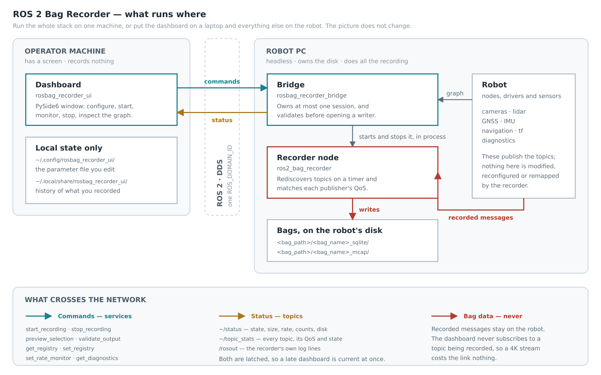
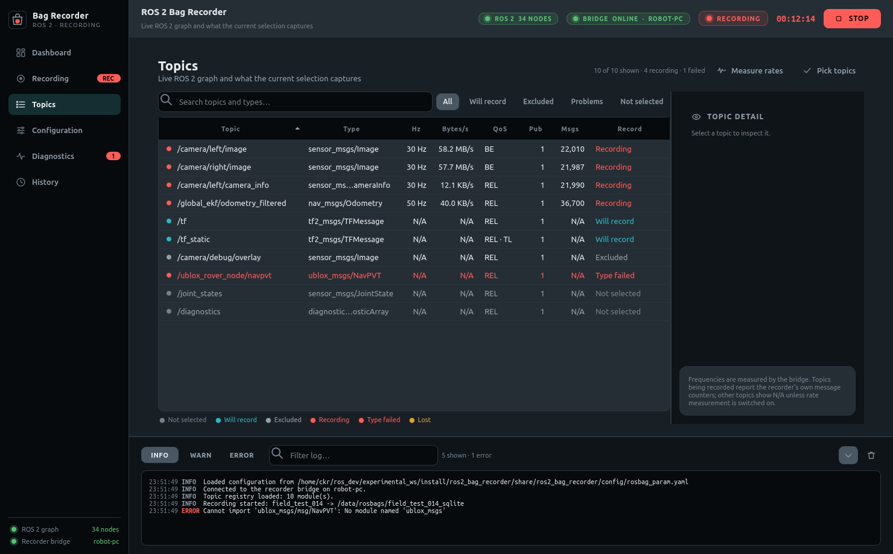

# ROS 2 Bag Recorder

**Record the same ROS 2 topics, the same way, every run.**

Define them once in YAML instead of maintaining a 40-topic `ros2 bag record` command.
Start it from a terminal, or from a dashboard on your laptop while the robot writes the bag.

[](https://docs.ros.org/en/humble/) [](https://releases.ubuntu.com/22.04/) [](LICENSE)

<p align="center">
  
</p>

<p align="center">
  <sub>20 seconds, real UI. <a href="docs/dashboard_ex.mp4">Download the MP4</a> for full resolution and sound.</sub>
</p>

- **Pick topics in YAML :** by module, by keyword, or by ticking them in the UI.
- **Never write message types :** They come from the live ROS graph.
- **Late topics are caught.** The graph is re-scanned while recording, not only at startup.
- **`sqlite3`, MCAP, or both** in a single pass.
- **The recorder is headless.** The dashboard is optional, and can run on your laptop while the robot records.

---

## Documentation

- [Quick start](#quick-start) : install, build, run
- [How it works](#how-it-works) : what runs where, and how the robot and your laptop talk
- [Usage](#usage) : terminal, dashboard, remote robot, or from your own code
- [Configuration](#configuration) : the two YAML files

---

## Why not just `ros2 bag record`?

Use `ros2 bag record` for a one-off. Use this when you record the same robot every day.

| | `ros2 bag record` | ROS 2 Bag Recorder |
|---|---|---|
| Topic list lives in | a shell alias | a version-controlled YAML file |
| Selecting topics | name them all, every time | modules, keywords, or tick them in a UI |
| Topic that appears late | missed | picked up automatically |
| Topic that is renamed | silently missed | reported as unmatched, by name |
| Message type missing | the run fails | that topic is skipped and logged |
| Output formats | one per run | `sqlite3` + MCAP in one pass |
| Remote operation | ssh in and hope | a dashboard on your laptop |
| Starting a recording from code | spawn a process | call a ROS 2 service |

---

## Features

| | |
|---|---|
| **Topic selection** | Registry modules, substring keywords, or hand-ticked. Regex excludes applied last, so an exclusion always wins. |
| **QoS matching** | Per publisher, so `best_effort` sensor streams and `transient_local` topics like `/tf_static` are both captured. |
| **Live discovery** | Topics that start publishing mid-recording are added on the fly. |
| **Pre-flight** | Path, name collision, disk space, storage plugin and selection are checked **on the recording machine**. `START` unlocks only when they pass. |
| **Topic table** | Every topic on the graph, coloured by what your selection does to it: *will record*, *excluded*, *recording*, *type failed*, *lost*. |
| **Preview** | Computed by the same code the recorder uses, so it cannot drift from what actually gets recorded. |
| **Editable registry** | Add topics, patterns and modules from the UI and save back to the robot, validated before it is written. |
| **Remote** | Bridge on the robot, window on your laptop. Recorded data never crosses the network. |
| **Scriptable** | Any ROS 2 node, a mission script, a state machine can drive recordings through the same services. |
| **Crash-safe** | Close the dashboard, lose the network or kill the GUI; the recording carries on and closes cleanly. |

---

## Quick start

**Requires** [Ubuntu 22.04](https://releases.ubuntu.com/22.04/) · [ROS 2 Humble](https://docs.ros.org/en/humble/)

```bash
# 1. dependencies
sudo apt install ros-humble-rosbag2-py                 # required
sudo apt install ros-humble-rosbag2-storage-mcap       # optional: MCAP output
sudo apt install libxcb-cursor0 python3-psutil         # dashboard
pip3 install --user PySide6                            # dashboard
```

<!-- TODO: replace with the public repository URL before release -->

```bash
# 2. build
cd ~/ros2_ws/src
git clone <REPOSITORY-URL> ros2-bag-recorder
cd ~/ros2_ws
source /opt/ros/humble/setup.bash
colcon build --symlink-install
source install/setup.bash
```

```bash
# 3. run
ros2 launch rosbag_recorder_ui dashboard.launch.py     # dashboard
ros2 launch ros2_bag_recorder recorder.launch.py       # terminal only
```

Recorder only, without the GUI dependencies:

```bash
colcon build --symlink-install --packages-select ros2_bag_recorder
```

> **Note** `libxcb-cursor0` is not optional for the dashboard. Qt 6.5+ needs it, the PySide6 wheel does not ship it, and Ubuntu 22.04 does not install it by default. Without it Qt aborts with a misleading "reinstall the application" message.

---

## How it works

<p align="center">
  
</p>

- The dashboard sends **commands** and receives **status** over ROS 2 services and topics.
- Recorded data never crosses that boundary, it goes straight onto the robot's own disk. A 4K camera stream costs the dashboard nothing.
- One machine or two: the picture is the same, only the latency differs.-
- Diagram source: [`docs/architecture.drawio`](docs/architecture.drawio) editable in [diagrams.net](https://app.diagrams.net/). Re-export to `docs/architecture.png` after changing it.
- Diagram source: [`docs/architecture.drawio`](docs/architecture.drawio). Re-export to `docs/architecture.png` after editing.

---

## Usage

### 1. Record from a terminal

Edit [`rosbag_param.yaml`](ros2_bag_recorder/config/rosbag_param.yaml), then:

```bash
ros2 launch ros2_bag_recorder recorder.launch.py
```

Stop with `Ctrl-C`. Bags land in `bag_folder.path` (default `~/rosbags`).

To use a parameter file somewhere else:

```bash
ros2 launch ros2_bag_recorder recorder.launch.py params_file:=/path/to/my_params.yaml
```

### 2. Record from the dashboard

Starts the bridge and the window together:

```bash
ros2 launch rosbag_recorder_ui dashboard.launch.py
```

For an entry in the Ubuntu application grid that sources ROS and this workspace for you:

```bash
ros2 run rosbag_recorder_ui install_desktop_entry
```

> Closing the window shuts down the stack it started. A bridge you started yourself keeps recording.

### 3. Record on a robot, drive it from your laptop

Both machines need the same `ROS_DOMAIN_ID` and a route to each other.

```bash
# on the robot
ros2 launch rosbag_recorder_bridge bridge.launch.py default_bag_path:=/data/rosbags
```

```bash
# on your laptop
ros2 launch rosbag_recorder_ui dashboard.launch.py use_bridge:=false
```

Every path, check and number is then the robot's answer, not your laptop's.

### 4. Drive it from your own code

The bridge is a plain ROS 2 node, so a mission script can record without any of the UI:

```bash
ros2 service call /rosbag_recorder_bridge/start_recording \
  rosbag_recorder_msgs/srv/StartRecording \
  "{config: {selection_method: 'keywords', keywords: ['camera'],
             bag_path: '/data/rosbags', bag_name: 'run_42',
             append_timestamp: true, storage_sqlite: true,
             discovery_interval_sec: 1.0}}"

ros2 service call /rosbag_recorder_bridge/stop_recording \
  rosbag_recorder_msgs/srv/StopRecording "{}"
```

<p align="center">
  
</p>

---

## Configuration

Two files. The dashboard reads and writes the same ones.

### [`topic_registry.yaml`](ros2_bag_recorder/config/topic_registry.yaml) : what *can* be recorded

Topics grouped into **modules**. Each entry has exactly one key `topic` or `pattern`:

```yaml
camera:
  - topic: /camera/left/image         # an exact name
  - topic: /camera/right/camera_info
  - pattern: /camera/.+/image         # ...or match many with one regex (fullmatch)
```

- Mix both kinds freely in one module.
- Message types are **not** listed they come from the ROS graph at runtime.
- New module = a section here plus a toggle under `modules:` below.

### [`rosbag_param.yaml`](ros2_bag_recorder/config/rosbag_param.yaml) : what *is* recorded this run

| Key | Meaning |
|---|---|
| `selection_method` | `'registry'`, `'keywords'` or `'manual'` |
| `keywords` | Substring keywords; `keywords` mode only, e.g. `['camera', 'gps']` |
| `manual_topics` | Exact topic names; `manual` mode only, written by the dashboard |
| `modules.<name>` | Toggle a registry module; `registry` mode only |
| `exclude_patterns` | Regex blocklist, applied last — always wins |
| `bag_folder.path` / `.name` | Where bags are written |
| `bag_folder.append_timestamp` | Suffix `_YYYY-MM-DD_HH-MM-SS`, avoids collisions |
| `storage_id.sqlite` / `.mcap` | Enable either or both output formats |
| `discovery_interval_sec` | How often the graph is re-scanned for new topics |
| `registry_file` | An alternative registry. Empty uses the packaged one. |

### Selection modes

| Mode | Records | Good for |
|---|---|---|
| **`registry`** | The topics in the modules you enable | Curated, repeatable recordings |
| **`keywords`** | Every live topic whose name *contains* a keyword | Quick ad-hoc capture, no registry edit |
| **`manual`** | Exactly the topics ticked in the dashboard | Refining a selection by hand |

Example : `keywords: ['camera', 'gps']` records `/camera/left/image`, `/front/camera_info`, `/gps/fix`, `/ublox/gps_raw`, and anything else matching.

> **`manual` is a dashboard mode.** The recorder understands only `registry` and `keywords`, so a `manual` file run through `ros2 launch` stops with a clear error. The dashboard writes an equivalent registry beside it so the selection still replays from a terminal

### Good to know

- Timestamps are **receive time** (node clock), like `ros2 bag record`.
- Message packages must be installed **on the recording machine**. A topic whose type will not import is skipped and logged the rest of the bag is unaffected.
- Anything the dashboard could not measure reads `N/A`. Never a zero, never a guess.

---

## Project structure

```
ros2-bag-recorder/
├── ros2_bag_recorder/         The recorder. Standalone, no GUI dependency.
│   ├── config/                topic_registry.yaml, rosbag_param.yaml
│   ├── launch/                recorder.launch.py
│   └── ros2_bag_recorder/     multiple_topic.py, topic_selection.py
│
├── rosbag_recorder_msgs/      Service and message definitions. No code.
│   ├── msg/                   RecorderStatus, RecordingConfig, TopicStat, ...
│   └── srv/                   StartRecording, PreviewSelection, SetRegistry, ...
│
├── rosbag_recorder_bridge/    Headless lifecycle owner. Runs on the robot.
│   └── rosbag_recorder_bridge/
│                              bridge_node.py, session.py, recorder_api.py,
│                              graph.py, rate_monitor.py, sysinfo.py
│
├── rosbag_recorder_ui/        PySide6 dashboard. Runs wherever you are.
│   └── rosbag_recorder_ui/
│       ├── core/              theme, config store, history, formatting, icons
│       ├── ros/               the only file that touches rclpy
│       ├── views/             one module per page
│       └── widgets/           cards, indicators, log panel, sidebar
│
└── docs/                      architecture diagram, screenshots, demo clip
```

---

## Contributing

Issues and pull requests are welcome.

- Open an issue before a large change.
- Keep `ros2_bag_recorder` usable on its own it must work with none of the other three packages installed.
- Run the tests before opening a PR.
- Match the style of the file you are editing, including its comment density.

---

## License

Apache License 2.0
